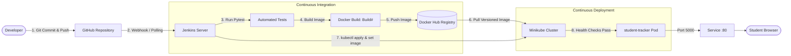

# 🚀 DevOps Student Task Tracker

> A complete, beginner-friendly academic project designed for **Cloud Computing and DevOps** assignments and practical evaluations. Features a Python Flask web application automated with a **Jenkins CI/CD pipeline**, **Docker**, **Docker Hub**, and orchestrated on **Kubernetes (Minikube)**.

---

## 📋 Table of Contents
1. [Project Overview & Architecture](#-project-overview--architecture)
2. [Technology Stack](#-technology-stack)
3. [Repository Directory Structure](#-repository-directory-structure)
4. [Configuration Placeholders Checklist](#-configuration-placeholders-checklist)
5. [Local Development & Testing](#-local-development--testing)
6. [Docker Guide (Local Build & Run)](#-docker-guide-local-build--run)
7. [AWS EC2 Host Server Setup](#-aws-ec2-host-server-setup)
8. [Jenkins Configuration & Credentials](#-jenkins-configuration--credentials)
9. [Minikube & Kubernetes Setup](#-minikube--kubernetes-setup)
10. [End-to-End Pipeline Execution](#-end-to-end-pipeline-execution)
11. [Accessing the Application & Verification](#-accessing-the-application--verification)
12. [Step-by-Step Assignment Demonstration Walkthrough](#-step-by-step-assignment-demonstration-walkthrough)
13. [Troubleshooting & Common Errors](#-troubleshooting--common-errors)

---

## 🏗 Project Overview & Architecture

The **DevOps Student Task Tracker** is a responsive web application designed for students to track coursework, lab assignments, and exam prep. It uses an in-memory datastore (no external database required) and exposes live health and version check endpoints.

Every code change pushed to GitHub automatically triggers a Jenkins Declarative Pipeline that tests the code, builds an immutable Docker image, pushes it to Docker Hub with the build number as its tag, and performs a zero-downtime rolling update on a Minikube Kubernetes cluster.

### CI/CD Architecture Flow



---

## 🛠 Technology Stack

| Layer | Technology | Purpose |
| :--- | :--- | :--- |
| **Backend** | Python 3.12, Flask 3.0.3 | Web server, REST API, health and version endpoints |
| **WSGI Server** | Gunicorn 22.0.0 | Production-grade WSGI HTTP server |
| **Frontend** | HTML5, CSS3 (Vanilla), JavaScript | Responsive UI with real-time stats and category tags |
| **Automated Testing** | pytest 8.2.2 | Unit, integration, isolation, and route test cases |
| **Containerization** | Docker, Python 3.12-slim | Lightweight, non-root user container with health checks |
| **Container Registry** | Docker Hub | Public/private versioned image storage |
| **CI/CD Automation**| Jenkins (Declarative Pipeline) | Multi-stage pipeline automating test, build, push, and deploy |
| **Orchestration** | Kubernetes & Minikube | Automated deployment, service exposure, self-healing probes |
| **Cloud Host** | AWS EC2 (Ubuntu 22.04 LTS) | Single-node host running Jenkins, Docker, and Minikube |

---

## 📁 Repository Directory Structure

```text
devops-student-tracker/
├── app.py                     # Main Flask application and REST API
├── requirements.txt           # Production Python dependencies (Flask, Gunicorn)
├── requirements-dev.txt       # Development & testing dependencies (pytest)
├── Dockerfile                 # Multi-stage production container configuration
├── .dockerignore              # Files excluded from Docker container image
├── .gitignore                 # Files excluded from Git version control
├── Jenkinsfile                # Jenkins Declarative Pipeline definition
├── README.md                  # Comprehensive documentation and lab guide
├── pytest.ini                 # Pytest configuration settings
├── tests/
│   ├── __init__.py
│   └── test_app.py            # Automated test suite (12 isolated test cases)
├── templates/
│   ├── index.html             # Responsive task management dashboard
│   ├── 404.html               # Custom 404 error page
│   └── 500.html               # Custom 500 error page
├── static/
│   ├── css/
│   │   └── style.css          # Modern dark-mode UI stylesheet
│   └── js/
│       └── app.js             # Client-side dynamic interaction logic
└── k8s/
    ├── deployment.yaml        # Kubernetes Deployment (1 replica, probes, limits)
    └── service.yaml           # Kubernetes NodePort Service (Port 80 -> 5000)
```

---

## 🔍 Configuration Placeholders Checklist

Before running the pipeline or deploying, replace the following placeholders:

| Placeholder | Where Found | Replace With | Example |
| :--- | :--- | :--- | :--- |
| `your-dockerhub-username` | `Jenkinsfile` (line 10) | Your Docker Hub username | `johndoe` |
| `DOCKERHUB_USERNAME` | `k8s/deployment.yaml` (line 22) | Your Docker Hub username | `johndoe` |
| `dockerhub-creds` | `Jenkinsfile` (line 14) | Credentials ID created in Jenkins | `dockerhub-creds` |
| `https://github.com/...` | Jenkins Pipeline Job | Your GitHub repository URL | `https://github.com/johndoe/devops-student-tracker.git` |

---

## 💻 Local Development & Testing

You can run and test the application on your local machine before pushing to GitHub.

### 1. Prerequisites
- Python 3.11 or Python 3.12
- Git

### 2. Setup Virtual Environment
```bash
# Clone or navigate into the repository
cd devops-student-tracker

# Create a virtual environment
python -m venv venv

# Activate the virtual environment
# On Linux/macOS:
source venv/bin/activate
# On Windows (PowerShell):
.\venv\Scripts\Activate.ps1
# On Windows (cmd):
.\venv\Scripts\activate.bat
```

### 3. Install Dependencies
```bash
pip install --upgrade pip
pip install -r requirements-dev.txt
```

### 4. Run Automated Tests
```bash
pytest
```
*Expected Output:*
```text
tests/test_app.py::test_homepage_returns_200 PASSED
tests/test_app.py::test_health_endpoint_returns_healthy PASSED
tests/test_app.py::test_version_endpoint_default PASSED
tests/test_app.py::test_version_endpoint_custom_env PASSED
tests/test_app.py::test_add_task_success PASSED
tests/test_app.py::test_add_task_validation_error PASSED
tests/test_app.py::test_complete_task_success PASSED
tests/test_app.py::test_complete_nonexistent_task PASSED
tests/test_app.py::test_delete_task_success PASSED
tests/test_app.py::test_delete_nonexistent_task PASSED
tests/test_app.py::test_isolation_first_step PASSED
tests/test_app.py::test_isolation_second_step PASSED
============================== 12 passed in 0.85s ==============================
```

### 5. Start the Application Locally
```bash
python app.py
```
Open your browser and navigate to:
- Dashboard: [http://localhost:5000](http://localhost:5000)
- Health Check: [http://localhost:5000/health](http://localhost:5000/health)
- Version Check: [http://localhost:5000/version](http://localhost:5000/version)

---

## 🐳 Docker Guide (Local Build & Run)

Test the container locally using Docker.

### 1. Build the Docker Image
```bash
docker build -t your-dockerhub-username/student-tracker:local .
```

### 2. Run the Container
```bash
docker run -d \
  --name student-tracker-app \
  -p 5000:5000 \
  -e APP_VERSION=v1.0.0-local \
  your-dockerhub-username/student-tracker:local
```

### 3. Verify Container Status & Logs
```bash
# Check container status (notice the healthy status)
docker ps

# Check application logs
docker logs student-tracker-app

# Test the endpoints
curl http://localhost:5000/health
curl http://localhost:5000/version
```

### 4. Stop and Clean Up Container
```bash
docker stop student-tracker-app
docker rm student-tracker-app
```

---

## ☁️ AWS EC2 Host Server Setup

For an academic submission, running Jenkins, Docker, and Minikube on a single AWS EC2 instance is the industry-standard lab pattern.

### Recommended Instance Specification
- **AMI:** Ubuntu Server 22.04 LTS (HVM), SSD Volume Type
- **Instance Type:** `t3.medium` or `t3.large` (2 vCPU, 4-8 GB RAM is required for Minikube + Jenkins)
- **Storage:** 30 GB gp3 root EBS volume
- **Inbound Security Group Rules:**
  - `SSH` (Port 22) -> Your IP
  - `Custom TCP` (Port 8080) -> Anywhere `0.0.0.0/0` (Jenkins Web UI)
  - `Custom TCP` (Port 30080) -> Anywhere `0.0.0.0/0` (NodePort Application Access)
  - `Custom TCP` (Port 5000) -> Anywhere `0.0.0.0/0` (Direct test port)

### Step 1: Install Dependencies on Ubuntu EC2
SSH into your EC2 instance and run:
```bash
sudo apt update && sudo apt upgrade -y
sudo apt install -y openjdk-17-jdk git curl apt-transport-https ca-certificates gnupg lsb-release python3-pip python3-venv conntrack
```

### Step 2: Install Docker Engine
```bash
# Add Docker's official GPG key
sudo mkdir -p /etc/apt/keyrings
curl -fsSL https://download.docker.com/linux/ubuntu/gpg | sudo gpg --dearmor -o /etc/apt/keyrings/docker.gpg

# Set up repository
echo \
  "deb [arch=$(dpkg --print-architecture) signed-by=/etc/apt/keyrings/docker.gpg] https://download.docker.com/linux/ubuntu \
  $(lsb_release -cs) stable" | sudo tee /etc/apt/sources.list.d/docker.list > /dev/null

# Install Docker
sudo apt update
sudo apt install -y docker-ce docker-ce-cli containerd.io docker-compose-plugin

# Enable and start Docker service
sudo systemctl enable docker
sudo systemctl start docker

# Add ubuntu user to docker group
sudo usermod -aG docker ubuntu
```

### Step 3: Install Jenkins
```bash
# Add Jenkins GPG key
sudo wget -O /usr/share/keyrings/jenkins-keyring.asc https://pkg.jenkins.io/debian-stable/jenkins.io-2023.key

# Add Jenkins repository
echo "deb [signed-by=/usr/share/keyrings/jenkins-keyring.asc] https://pkg.jenkins.io/debian-stable binary/" | sudo tee /etc/apt/sources.list.d/jenkins.list > /dev/null

# Install Jenkins
sudo apt update
sudo apt install -y jenkins

# Grant Jenkins permission to run Docker commands
sudo usermod -aG docker jenkins

# Restart Jenkins to apply group permissions
sudo systemctl restart jenkins
sudo systemctl enable jenkins
```

### Step 4: Install kubectl
```bash
curl -LO "https://dl.k8s.io/release/$(curl -L -s https://dl.k8s.io/release/stable.txt)/bin/linux/amd64/kubectl"
sudo install -o root -g root -m 0755 kubectl /usr/local/bin/kubectl
kubectl version --client
```

### Step 5: Install and Start Minikube
```bash
# Download and install Minikube
curl -LO https://storage.googleapis.com/minikube/releases/latest/minikube-linux-amd64
sudo install minikube-linux-amd64 /usr/local/bin/minikube
rm minikube-linux-amd64

# Start Minikube using Docker driver as ubuntu user
minikube start --driver=docker

# Verify Minikube status
minikube status
kubectl get nodes
```

---

## 🔑 Jenkins Configuration & Credentials

### Step 1: Unlock Jenkins
1. Open your browser and go to `http://<EC2-PUBLIC-IP>:8080`.
2. Retrieve the initial admin password from your terminal:
   ```bash
   sudo cat /var/lib/jenkins/secrets/initialAdminPassword
   ```
3. Click **"Install suggested plugins"**.
4. Create an admin user or proceed as admin.

### Step 2: Install Required Jenkins Plugins
Navigate to **Manage Jenkins > Plugins > Available Plugins**, search for and install:
- **Docker Pipeline**
- **Pipeline: Stage View**
- **Credentials Binding Plugin** (usually pre-installed)
- **JUnit Plugin** (usually pre-installed)

### Step 3: Add Docker Hub Credentials
1. Go to **Manage Jenkins > Credentials > System > Global credentials (unrestricted)**.
2. Click **+ Add Credentials**.
3. Fill in the fields:
   - **Kind:** Username with password
   - **Scope:** Global
   - **Username:** Your Docker Hub username (e.g. `johndoe`)
   - **Password:** Your Docker Hub Personal Access Token (or password)
   - **ID:** `dockerhub-creds` *(CRITICAL: Must match Jenkinsfile exactly)*
   - **Description:** Docker Hub Login Credentials
4. Click **Create**.

### Step 4: Configure Kubeconfig Permissions for Jenkins
Because Minikube was initialized by the `ubuntu` user, Jenkins running under the `jenkins` system account needs read access to the cluster kubeconfig:

```bash
# Create .kube directory for jenkins user
sudo mkdir -p /var/lib/jenkins/.kube

# Copy kubeconfig from ubuntu user
sudo cp /home/ubuntu/.kube/config /var/lib/jenkins/.kube/config

# Fix ownership so jenkins can read it
sudo chown -R jenkins:jenkins /var/lib/jenkins/.kube

# Also ensure minikube certificates are readable by jenkins
sudo chmod -R 755 /home/ubuntu/.minikube

# Verify jenkins can access the cluster
sudo -u jenkins KUBECONFIG=/var/lib/jenkins/.kube/config kubectl get nodes
```
*Expected Output:*
```text
NAME       STATUS   ROLES           AGE   VERSION
minikube   Ready    control-plane   10m   v1.30.0
```

---

## ☸️ Minikube & Kubernetes Setup

The Kubernetes resources are defined in `k8s/`:
- **`k8s/deployment.yaml`**: Deploys 1 replica of the container, configures `APP_VERSION`, resource constraints (`100m` CPU / `128Mi` RAM), and HTTP liveness/readiness probes at `/health`.
- **`k8s/service.yaml`**: Exposes the application on Port 80, routing to container port 5000, mapped to `nodePort: 30080`.

### Manual Testing of Manifests (Optional)
```bash
# Apply manifests
kubectl apply -f k8s/deployment.yaml
kubectl apply -f k8s/service.yaml

# Check pods
kubectl get pods -l app=student-tracker

# Check service
kubectl get service student-tracker-service
```

---

## 🔄 End-to-End Pipeline Execution

### Step 1: Push Code to GitHub
```bash
cd devops-student-tracker
git init
git add .
git commit -m "feat: Initial commit of DevOps Student Task Tracker"
git branch -M main
git remote add origin https://github.com/<YOUR-GITHUB-USERNAME>/devops-student-tracker.git
git push -u origin main
```

### Step 2: Create Jenkins Pipeline Job
1. In Jenkins, click **New Item**.
2. Enter name: `student-tracker-pipeline`.
3. Select **Pipeline** and click **OK**.
4. Scroll to the **Pipeline** section:
   - **Definition:** Pipeline script from SCM
   - **SCM:** Git
   - **Repository URL:** `https://github.com/<YOUR-GITHUB-USERNAME>/devops-student-tracker.git`
   - **Branch Specifier:** `*/main`
   - **Script Path:** `Jenkinsfile`
5. Click **Save**.

### Step 3: Trigger Build
Click **Build Now**.
Watch the Pipeline stages execute:
1. `Checkout SCM` (Clones repository)
2. `Test & Quality Gate` (Executes 12 pytest tests and archives JUnit XML)
3. `Docker Build` (Builds Docker image tagged with `${BUILD_NUMBER}`)
4. `Docker Hub Push` (Logs into Docker Hub securely and pushes image)
5. `Kubernetes Deploy` (Applies manifests and updates image to `${BUILD_NUMBER}`)
6. `Verify Rollout` (Monitors rollout status until pod is healthy)

---

## 🌐 Accessing the Application & Verification

### Option A: Via Minikube NodePort on EC2 (Public Access)
To access the app from your laptop browser via the EC2 Public IP:

1. In your EC2 terminal, run a background port forward from EC2 port 30080 to Minikube:
   ```bash
   kubectl port-forward --address 0.0.0.0 service/student-tracker-service 30080:80 &
   ```
2. Open your browser:
   - **Web UI:** `http://<EC2-PUBLIC-IP>:30080`
   - **Health Endpoint:** `http://<EC2-PUBLIC-IP>:30080/health`
   - **Version Endpoint:** `http://<EC2-PUBLIC-IP>:30080/version`

### Option B: Via Minikube Service URL (Direct EC2 Terminal)
```bash
# Get the Minikube URL
minikube service student-tracker-service --url

# Test with curl inside EC2
curl $(minikube service student-tracker-service --url)/health
curl $(minikube service student-tracker-service --url)/version
```

Sample JSON response from `/health`:
```json
{
  "status": "healthy",
  "timestamp": "2026-10-15T09:30:00.000000+00:00",
  "version": "v1.0.1"
}
```

---

## 🎬 Step-by-Step Assignment Demonstration Walkthrough

When presenting this project for an evaluation or viva, follow these steps to demonstrate a complete CI/CD lifecycle:

### Step 1: Show Baseline State
1. Open the web UI in the browser. Note the version displayed in the top right badge (e.g., `v1.0.1`).
2. Show the Kubernetes pods:
   ```bash
   kubectl get pods -l app=student-tracker -o wide
   ```

### Step 2: Make a Code Modification
1. Edit `templates/index.html` or `app.py` (e.g. change subtitle or add a default category).
2. Or update a task title.

### Step 3: Commit and Push
```bash
git add .
git commit -m "feat: Updated task dashboard UI for lab demonstration"
git push origin main
```

### Step 4: Run Jenkins Pipeline
1. Click **Build Now** in Jenkins (Build #2).
2. Show the evaluator the build console logs:
   - Pytest tests passing.
   - Docker image built with tag `:2`.
   - Docker Hub receiving `:2`.
   - `kubectl set image deployment/student-tracker student-tracker=your-dockerhub-username/student-tracker:2`.
   - `kubectl rollout status` confirming successful zero-downtime rolling update.

### Step 5: Verify New Version in Browser
1. Refresh the web UI.
2. The version badge dynamically updates to `v1.0.2` without manual container restarting!
3. Query `curl http://<EC2-IP>:30080/version` to prove the live pod is running the new release.

---

## 🚨 Troubleshooting & Common Errors

### 1. `docker: Got permission denied while trying to connect to the Docker daemon socket`
- **Cause:** The `jenkins` user is not part of the `docker` OS group.
- **Fix:**
  ```bash
  sudo usermod -aG docker jenkins
  sudo systemctl restart jenkins
  ```

### 2. `The connection to the server localhost:8080 was refused - did you specify the right host or port?`
- **Cause:** `kubectl` is looking for kubeconfig at `/root/.kube/config` or the Jenkins user does not have `KUBECONFIG` set.
- **Fix:** Ensure `/var/lib/jenkins/.kube/config` exists and is owned by `jenkins`:
  ```bash
  sudo mkdir -p /var/lib/jenkins/.kube
  sudo cp /home/ubuntu/.kube/config /var/lib/jenkins/.kube/config
  sudo chown -R jenkins:jenkins /var/lib/jenkins/.kube
  sudo chmod -R 755 /home/ubuntu/.minikube
  ```

### 3. `ErrImagePull` or `ImagePullBackOff` in Kubernetes
- **Cause:** Docker Hub image tag was not pushed, repository name is misspelled, or repository is private.
- **Fix:**
  - Verify image exists on Docker Hub: visit `https://hub.docker.com/r/<your-username>/student-tracker`.
  - Check pod event logs:
    ```bash
    kubectl describe pod -l app=student-tracker
    ```

### 4. `CrashLoopBackOff` or Liveness Probe Failure
- **Cause:** The application failed to start or failed to respond to `GET /health` within the timeout window.
- **Fix:**
  - Check container logs:
    ```bash
    kubectl logs -l app=student-tracker
    ```
  - Increase `initialDelaySeconds` in `k8s/deployment.yaml` if the EC2 host has high CPU load.

### 5. `docker login` fails in Jenkins stage
- **Cause:** Credential ID mismatch.
- **Fix:** Ensure the credential ID in Jenkins is exactly `dockerhub-creds` with Kind set to **Username with password**.

---

## 📜 License & Academic Integrity
This project is prepared for educational purposes for Cloud Computing and DevOps CCA assignments. Feel free to reference, adapt, and build upon it!
